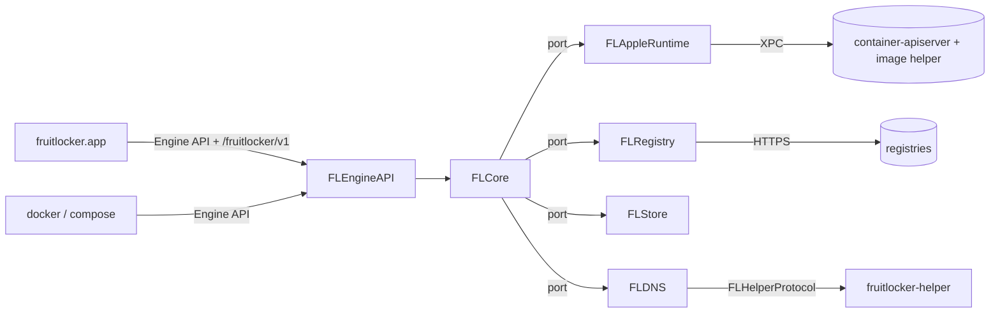
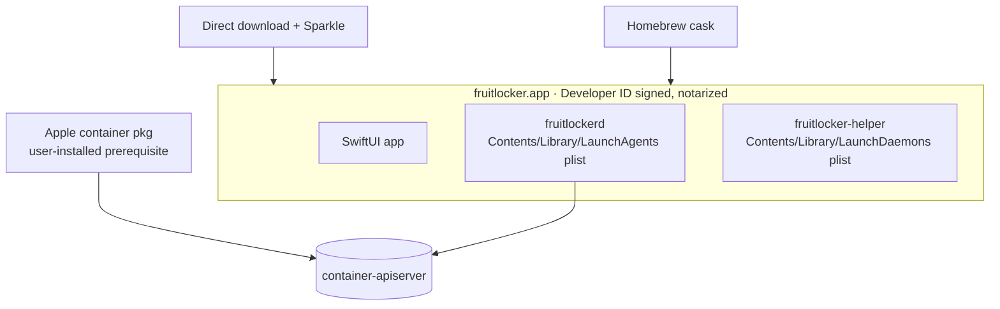

# Architecture Spine — fruitlocker v1

## Design Paradigm

**Hexagonal (ports and adapters)** around a Docker domain core, with **reconcile-loop controllers** for the behavior Apple's runtime lacks. Swift 6 strict concurrency.

| Layer | Module | Holds |
|---|---|---|
| Core (domain) | `FLCore` | Object model, services, ports, `EventBus`, runtime poller, controllers, `Resolver` |
| Driving adapter | `FLEngineAPI` | Engine API HTTP over the Unix socket (Hummingbird), `/fruitlocker/v1/*`, request-field table |
| Driven adapter | `FLAppleRuntime` | `ContainerAPIClient` over XPC |
| Driven adapter | `FLRegistry` | Registry transfer (Containerization `RegistryClient`) |
| Driven adapter | `FLStore` | SQLite: spec, observed state, references, intent ledger |
| Driven adapter | `FLDNS` | Packet I/O and answers on handed-over sockets; `HostNetObserver` |
| Shared contract | `FLHelperProtocol` | Daemon↔helper XPC, versioned |
| Executables | `fruitlockerd`, `fruitlocker-helper`, `fruitlocker.app` | Composition roots only |



Dependency rule: adapters depend on `FLCore`, and `FLCore` depends on no adapter. Adapters never import each other. The helper depends only on `FLHelperProtocol`, and the app depends on no engine module.

## Invariants & Rules

### AD-1 — Three processes, one bundle, one user
- **Binds:** packaging, app, daemon, helper
- **Prevents:** engine lifetime tied to the UI; version skew between processes; two users' daemons fighting over one helper
- **Rule:**
  - `fruitlocker.app` is UI only.
  - `fruitlockerd` is a per-user LaunchAgent that runs with or without the app open.
  - `fruitlocker-helper` is a root LaunchDaemon that does AD-9 and nothing else.
  - Both services are registered with `SMAppService` from the same bundle, so all three come from one build.
  - `FLHelperProtocol` opens with a version handshake. On a mismatch the helper refuses, and the daemon re-registers it.
  - v1 is single-user: the helper serves one daemon connection at a time. A new connection that passes the AD-9 peer check replaces the current one. The helper holds no state, so nothing is lost.

### AD-2 — Only the daemon talks to Apple
- **Binds:** all modules
- **Prevents:** two writers of Apple state; CLI scraping
- **Rule:**
  - Only `FLAppleRuntime`, inside `fruitlockerd`, links `ContainerAPIClient`. The app and helper never contact Apple's services.
  - Nothing parses `container` CLI output.
  - One exception: the daemon may run `container system start` (with kernel install) to bring Apple's services up, and never reads its output beyond the exit code.

### AD-3 — Three state classes, one owner each [ADOPTED in part]
- **Binds:** every object, every controller, `inspect`
- **Prevents:** two sources of truth; state with no home (health, restart count)
- **Rule:**
  - **Spec** (desired, in `FLStore`): config, names, labels, restart policy, healthcheck, network attachments and aliases, port bindings requested, volume metadata, resolved image ID.
  - **Observed** (in `FLStore`, separate from spec) is two tables. Every column has exactly one writer.
    - `container_observed(dockerID)`, per container:
      - `ContainerService` writes `generation`, `manuallyStopped` and `runEpoch`. `runEpoch` goes up on every start.
      - `RestartController` writes `restartCount` and backoff.
    - `run_observed(dockerID, runEpoch)`, per run:
      - `HealthController` writes health, which resets with each new run.
      - The record-exit function (AD-6) writes start and exit times and the exit code.
  - **Runtime** comes from Apple, is read live, and is never persisted as truth.
  - `inspect` is spec + observed + runtime, assembled by one core function that reads spec and observed in a single store read transaction.
  - **Materialization:**
    - Write the spec `pending`, then create the Apple object, then mark it `materialized` with its `specHash`.
    - The Apple container is created at first start and reused after that.
    - `specHash` covers only the canonical Apple `ContainerConfiguration` the spec produces. Networks are ordered by `gw_priority` descending, then by name.
  - **Spec edits Apple can't apply in place** (networks, mounts, env, ports) set `needsRecreate`. The next start recreates the Apple container, losing its writable layer but not its volumes, and returns a Docker `Warnings` entry plus a `Type=daemon` event [ADOPTED].
    - Recreate write order: record `recreating{oldAppleID, newAppleID}` first, then create the new object, then delete the old one, then mark it `materialized`.
    - The new Apple ID is minted per AD-4.
  - Apple objects carry only the label `fl.docker.id`.

### AD-4 — Identity and visibility [ADOPTED in part]
- **Binds:** all objects, every handler, the poller, the sweeper
- **Prevents:** join-key drift; ID collisions; foreign objects leaking into Docker views
- **Rule:**
  - **Docker IDs:** containers and networks get 64-hex Docker IDs minted by the daemon.
  - **Apple IDs:**
    - The Apple ID is `fl-<12 hex>`. The minter re-rolls until that prefix is unique across `FLStore` and the last runtime snapshot.
    - Volumes are keyed by Docker name. Anonymous volumes get 64-hex names, and the Apple ID is `fl-<12 hex of sha256(name)>`.
  - **Join key:** `fl.docker.id` is the only Apple→Docker join key. An `fl-` object without a matching label and spec is foreign and never adopted.
  - **Visibility:** the Engine API lists only objects that are joined this way. Apple-native objects stay hidden in v1 [ADOPTED].
  - **Lookup:** one `Resolver` in `FLCore` applies Docker's lookup order (full ID, exact name, unique prefix; an ambiguous prefix is an error). Every handler uses it.
  - **Hostname:** the guest hostname comes from the spec, defaulting to the short ID.
  - **Image IDs:** Apple's `descriptor.digest` (the manifest or index digest).

### AD-5 — One image store, one volume store
- **Binds:** images, build, volumes
- **Prevents:** a second content or volume store drifting from Apple's
- **Rule:**
  - Apple's image store is the only image store, and Apple's volume store is the only volume store.
  - The daemon keeps no layers and no volume data. It keeps spec metadata only, per AD-3.

### AD-6 — One event path
- **Binds:** `/events`, controllers, the app
- **Prevents:** duplicate, missing, phantom or reordered events
- **Rule:**
  - **One bus:** `EventBus` in `FLCore`, with a bounded history buffer it owns for `since=`.
  - **Emitter table:** each `(Type, Action)` has exactly one emitter, listed in Conventions. The table is total: an action that isn't listed is never emitted.
  - **Publish timing:** an event is published only after the runtime call succeeds *and* the store commits. Per object, events are delivered in publication order.
  - **Intent ledger:**
    - Before a runtime call, each core mutation records `{dockerID, runEpoch, op, from, to, generation}`.
    - `op` covers run-state changes as well as `materialize` and `dematerialize`.
    - An entry matches only diffs on the same `runEpoch`.
    - No entry survives boot (AD-16).
  - **The poller:**
    - It is a core service, and the only code that reads Apple on a timer.
    - It diffs runtime against *observed* state, not against its last snapshot, and suppresses matching ledger entries.
    - It never awaits an object lock. It hands each observation to a per-object record task.
  - **Exactly one `die` per `(dockerID, runEpoch)`:**
    - The poller and `ClientProcess.wait` (the fast path for init processes the daemon started) both feed one record-exit function.
    - Whichever path records the exit first emits the event. A later path is a no-op.
  - **Host network:** bridge up/down and mDNSResponder's `udp4 *:53` state come from the `HostNetObserver` port and are published on the bus.

### AD-7 — One mutation path, per-object serialization
- **Binds:** `FLEngineAPI`, `FLCore`, `FLStore`
- **Prevents:** reentrant interleaving at `await` points; check-then-act races across kinds; deadlocks
- **Rule:**
  - HTTP handlers call core services only. Core services, the poller included, are the only callers of the runtime, registry and store ports.
  - **Per-object lock:** each object ID has an async FIFO mutex, held across every `await` of a mutation. Different objects mutate concurrently, and reads take no object lock.
  - **References:** every reference between objects (container→network, container→volume, container→image) is a foreign-key row in `FLStore`. Existence, in-use and implicit-create checks, together with the referencing write, happen in one transaction.
  - **Who owns attachments:** `ContainerService` owns container→network rows. `NetworkService` calls it to connect or disconnect.
  - **In use:** a network or volume counts as in use when any spec references it *or* any materialized Apple container is still attached to it.
    - `network rm` first dematerializes stopped containers whose only remaining link is a stale attachment.
    - That covers Compose's stop → disconnect → rm → create → connect → start sequence.
  - **Images:** an image that any container spec references is never deleted from Apple's store. `rmi -f` only untags it.
  - **Lock order:** network → volume → image → container (ascending ID within a kind), then per-network lifecycle mutexes (AD-10) as leaf locks.
    - Lifecycle mutexes are taken in ascending network ID.
    - No object lock is taken while one is held.

### AD-8 — Behavior Apple lacks is a controller
- **Binds:** restart, health, DNS view, network lifecycle
- **Prevents:** emulations scattered through handlers; controllers fighting; stale actions
- **Rule:**
  - Each controller lives in `FLCore`, subscribes to the `EventBus`, reads spec and observed state, and acts only through core services.
  - **Generations:** an action carries the `(generation, runEpoch)` it observed and is rejected unless both still match. User mutations bump the `generation`.
  - **Start cause:** the `start` event carries `fl.cause=user|policy|boot`.
  - **Health:** health never changes run state, and it never triggers a restart.
  - **Pre-mutation hook:** the only one allowed is `NetworkLifecycle` (AD-10).
  - **Controller-to-controller:** the one allowed call is `NetworkLifecycle` → `DNSViewController.withdraw(container)`.
  - **Boot:** a controller stays inert until its boot step (AD-16).
  - **Upstream:** a controller is deleted when Apple ships the behavior.

### AD-9 — DNS: the helper binds, the daemon owns [ADOPTED]
- **Binds:** `FLDNS`, `fruitlocker-helper`, `FLHelperProtocol`
- **Prevents:** root parsing guest traffic; a forgotten duplicate fd keeping `:53` bound; any local process getting root binds
- **Rule:**
  - **Peer checks:** the helper accepts only peers matching the daemon's code-signing requirement (Team ID + `sh.jawr.fruitlocker.daemon`). The daemon checks the helper the same way.
  - **What it binds:** only `<gateway>:53` UDP with `SO_REUSEADDR`, and only an address that is currently the IPv4 address of a vmnet bridge. Never the wildcard.
  - **Handover:** after passing the fd, the helper closes its copy at once. It keeps no fds, no bind state and no guard of its own.
  - **Ownership:** the daemon is the sole owner. Release means the daemon closes its fd, and if the daemon dies the kernel closes it.
  - **Socket port:** `FLDNS` runs on a `DatagramSocket` port, so a packet-relay helper can replace the fd handover without touching the core.
  - **One socket per gateway:** `FLDNS` holds at most one. A second handover for a gateway it already holds is closed at once and logged.
  - **Answers:** `FLDNS` answers from the current `DNSView` (AD-21), following the #4 resolver rules.
  - **No helper:** if the user refuses the helper, Compose names are unavailable, and a `/fruitlocker/v1` warning and a `Type=daemon` event say so. Apple alias DNS is not in v1.

### AD-10 — Network lifecycle and the #5 guard
- **Binds:** networks, DNS, every start and stop path
- **Prevents:** the #402/#4 wedge; late release; concurrent last-stops both skipping release
- **Rule:**
  - **Hooks:** `NetworkController` implements the `NetworkLifecycle` port.
    - Every core path that starts or stops a VM, for any reason, awaits `willStart`/`willStop` before calling the runtime.
    - It then calls `didStart`/`didStop(ok | failed)` after the runtime call. That call is mandatory, and a failure re-runs the guard.
  - **One lock:** all of a network's lifecycle state sits under its lifecycle mutex, a leaf lock (AD-7).
    - Every bind or release decision, whether it comes from a hook, a `HostNetObserver` event or the backstop, runs under that mutex.
    - It is recomputed from current state, never from an event payload.
  - **Count:** joined containers (AD-4) that are running or reserved to start, minus those reserved to stop. Membership comes from the AD-21 projection, extended to every fruitlocker network.
  - **Bind** only while all of these hold:
    - the count is above 0
    - no stop is reserved
    - the bridge is up
    - mDNSResponder holds `udp4 *:53`
  - **Release:** `willStop` on the last container withdraws its DNS entries, releases, and only then returns.
  - **Backstop** (continuous): release immediately when any of these happens. The window for crash exits is accepted.
    - an unexpected `die` of the last container
    - bridge-down
    - mDNSResponder drops `udp4 *:53`
    - a bridge has no joined container left among its attachments
  - **`bridge`:** fruitlocker's `bridge` network gateway is never bound. Guests on it use mDNSResponder, as on Docker's default bridge. Apple's `default` stays hidden.
  - It owns detecting and mitigating #8.

### AD-11 — Unsupported fails loudly; every field is classified
- **Binds:** `FLEngineAPI`, `FLCore`
- **Prevents:** silent no-ops
- **Rule:**
  - **Field table:** one table in `FLEngineAPI` classifies every request field as supported, accepted with a `Warnings` entry, or rejected. A non-default field missing from the table is rejected.
  - **Always rejected:** host networking, `container:` network mode, shared PID or IPC, host-level privileged mode, devices, Docker-in-Docker, and `network connect`/`disconnect` on a running container.
  - Connect or disconnect on a stopped container edits the spec (AD-3).
  - Endpoints that aren't implemented return 501.

### AD-12 — Apple version gate
- **Binds:** `FLAppleRuntime`, startup, image endpoints
- **Prevents:** running on Apple APIs outside what was tested
- **Rule:**
  - Link `ContainerAPIClient` at exactly 1.7.1.
  - **Apiserver:** it must be ≥ 1.7.1 with the same major. Checked at boot and on every apiserver reconnect.
  - **Image helper:** it has no compatibility promise, so image-helper calls are made on Apple versions in the tested allow-list only. On any other version, image endpoints still serve but add a warning.
  - The socket is always bound. While the gate fails, `/_ping`, `/version` and `/fruitlocker/v1/*` work, and everything else returns 503 `fruitlocker: engine unavailable: <reason>`.

### AD-13 — One socket for the app
- **Binds:** app, daemon
- **Prevents:** a second app↔daemon channel; app data that can't be joined to Docker objects
- **Rule:**
  - The app reads and writes engine state only over the daemon's socket: the Engine API for Docker objects, `/fruitlocker/v1/*` for engine-only concerns.
  - It controls the daemon *process* only through `SMAppService`: register, unregister, restart.
  - `/fruitlocker/v1` never lists Docker objects. It refers to one only by full Docker ID, under `/fruitlocker/v1/<kind>/<id>/…`.
  - It is additive-only within v1.
  - Changes to engine-only state appear on `/events` as `Type=daemon` events with `fl.*` attributes.

### AD-14 — The daemon moves images; credentials are never stored [ADOPTED]
- **Binds:** pull, push, `/auth`, build
- **Prevents:** credentials persisted or written to Apple's keychain; `docker login` being ignored
- **Rule:**
  - `FLRegistry` pulls and pushes using that request's `X-Registry-Auth`.
  - A pull lands in Apple's store via `ClientImage.load`. A push reads the image via `ClientImage.save`.
  - Credentials live only for the request. They are never persisted and never written to any keychain.
  - `/auth` only validates.

### AD-15 — Docker context is additive
- **Binds:** app first run, settings, uninstall
- **Prevents:** clobbering the user's other Docker setups
- **Rule:**
  - fruitlocker creates and owns one context named `fruitlocker`, and never edits other contexts or `DOCKER_HOST`.
  - Switching to it records the previous context, and both undo and uninstall restore that record.

### AD-16 — Boot reconcile
- **Binds:** `fruitlockerd` startup, every controller
- **Prevents:** missed exits; orphans with no owner; DNS lost after a daemon restart; serving before state is known
- **Rule:**
  - **Fixed order:**
    1. Bind the socket and serve the status endpoints only.
    2. Bootstrap Apple's services if they're down (AD-2).
    3. Version gate (AD-12).
    4. Migrate the store (AD-18).
    5. Take a runtime snapshot. Resolve every open ledger entry against it, completing or rolling back each one.
    6. Sweep:
       - adopt labeled objects whose spec is `pending`
       - finish any `recreating` forward
       - mark a materialized spec whose Apple object is missing as `needsRecreate`
       - when two labeled objects share a Docker ID, keep the one the spec names
       - delete labeled objects that have no spec
    7. Ensure the `bridge` network exists.
    8. Publish one synthetic `resync`. `DNSViewController` and `NetworkController` activate and rebind per the guard.
    9. `RestartController` activates and applies Docker's daemon-start rules from `manuallyStopped`. This is the only daemon-start restart path.
    10. Health and the remaining controllers activate. Open the object endpoints.
  - Controllers derive state from spec + observed + snapshot, never from event history.
  - An apiserver reconnect re-runs steps 3 and 5–10, and object endpoints return 503 until it finishes.

### AD-17 — Local security boundary
- **Binds:** socket, helper, app
- **Prevents:** a user-equivalent socket exposed to others; root actions on behalf of arbitrary callers
- **Rule:**
  - The Engine API is a Unix socket only, never TCP.
  - The socket file is `0600` inside a `0700` directory, both owned by the user.
  - The helper and daemon verify each other per AD-9, and v1 is single-user per AD-1.
  - Any facade socket (Testcontainers, post-v1) needs its own AD.

### AD-18 — Store migrations
- **Binds:** `FLStore`, every module that adds tables
- **Prevents:** ad-hoc schema changes; corrupt stores after an update
- **Rule:**
  - All schema changes are named, append-only GRDB `DatabaseMigrator` migrations, and a migration is never edited.
  - They run at boot (AD-16) after the database file is copied.
  - A store newer than the binary keeps the gate failed (AD-12). Downgrade isn't supported.

### AD-19 — Published ports
- **Binds:** containers, networks, `inspect`
- **Prevents:** two port mechanisms; ephemeral ports allocated in two places
- **Rule:**
  - Ports are published through Apple's runtime when the container materializes.
  - Requested bindings are spec.
  - **Ephemeral host ports** (`0`, `-P`):
    - They are allocated when an Apple container is created, at first start or recreate. A plain start never allocates.
    - They go into a `host_ports` table, unique on `(hostIP, hostPort, proto)`, in the same transaction as the materialization write.
    - They are kept across stops and freed only on recreate or destroy.
  - Published ports land on the first network in AD-3's canonical order (Apple's behavior), and `inspect` reports exactly that.
  - A port conflict returns Docker's error.

### AD-20 — One log source
- **Binds:** `docker logs`, Compose `logs`, attach, the app's log view
- **Prevents:** the CLI and the app showing different output
- **Rule:**
  - Every consumer of container output reads one source through one core service.
  - Which source that is (a daemon log store or Apple's log) is decided by the stdio spike (Deferred) before any logs or attach work begins.
  - Whatever is chosen must keep containers running and writing across a daemon restart.

### AD-21 — One DNS view
- **Binds:** `FLDNS`, `NetworkController`, `inspect`
- **Prevents:** three membership views drifting; names on Docker's `bridge`; stale source-IP scope after an IP is reused
- **Rule:**
  - `DNSViewController` in `FLCore` is the only code that computes names. It projects spec + observed + runtime IPs for each user-defined network into an immutable, versioned `DNSView`, and pushes it to `FLDNS`. `FLDNS` derives nothing.
  - A querier's view is the union of the user-defined networks it's attached to.
  - The same function fills `NetworkSettings.Networks[*].DNSNames`, and `NetworkController` counts from the same projection (AD-10).
  - **Source-IP entries:**
    - They are keyed by `(IP, network)`.
    - Each one is installed inside the container's start operation, before the `start` event, and replaces any earlier entry for that IP.
    - It is withdrawn by the `willStop` hook or on `die`.
  - Containers on `bridge` aren't served at all; they use mDNSResponder (AD-10).

## Consistency Conventions

| Concern | Convention |
|---|---|
| Engine API version | Max 1.51, min 1.44, negotiated through `/_ping` and `/version`. Clients negotiate down to ≥ 1.40, and at ≥ 1.44 Compose sends every network at create |
| Socket and paths | `~/.fruitlocker/run/docker.sock` (no spaces, under 104 chars) `[ASSUMPTION]`; store in `~/Library/Application Support/fruitlocker/`. `FRUITLOCKER_HOME` moves the socket, store and context name together for dev builds; dev daemons never register the release helper |
| Bundle and log ids | `sh.jawr.fruitlocker`, `.daemon`, `.helper` (dev builds add `.dev`) `[ASSUMPTION]`. Logging is OSLog only (subsystem = bundle id, category = module), with a diagnostics export at `/fruitlocker/v1/diagnostics` |
| Labels on Apple objects | `fl.docker.id` only. Docker labels live in the spec |
| Errors | Docker shape `{"message": "..."}`. Unsupported → 400 `fruitlocker: <option> is not supported: <reason>`. Unimplemented → 501. Gate failed → 503. Apple errors map to the nearest Docker status and keep Apple's message. Degradations go in Docker's `Warnings` array |
| Event emitters (total, per AD-6) | `ContainerService`: container `create`, `start`, `restart`, `kill`, `stop`, `destroy`, `rename`, `update`, `pause`, `unpause`, `attach`, `resize`, `exec_create`, `exec_start`, `exec_die`, `prune`, plus network `connect`/`disconnect` and volume `mount`/`unmount` inside its operations, and `Type=daemon` `fl.recreate`. Record-exit function: `die`, `oom`. `NetworkService`: network `create`, `destroy`, `prune`. `VolumeService`: volume `create`, `destroy`, `prune`. `ImageService`: image `pull`, `push`, `tag`, `untag`, `delete`, `load`, `save`, `prune`. `HealthController`: `health_status`. `NetworkController`: `Type=daemon` `fl.dns.bound`, `fl.dns.released`, `fl.dns.unavailable`. Engine: `Type=daemon` `fl.gate`, `fl.compat.warning` |
| Time and ids | RFC 3339 UTC in JSON, Unix seconds wherever Docker uses them; IDs per AD-4 |
| Concurrency | Swift 6 language mode, strict concurrency; per-object locks per AD-7 |
| Network egress | None of fruitlocker's own except registries (AD-14), DNS upstreams (AD-9) and Sparkle update checks. No telemetry, accounts or hosted services |
| Tests | Core tests run against fake runtime, registry and host-net ports, with no VMs. Anything needing real VMs is a compatibility test |
| License | Apache-2.0; every dependency must be Apache-2.0-compatible |

## Stack

| Name | Version |
|---|---|
| Swift (language mode 6, tools 6.2) | 6.2+ (built with 6.4.2, Xcode 27.2) |
| macOS (deployment target) | 26.0 |
| apple/container (`ContainerAPIClient`) | 1.7.1 exact |
| apple/containerization (`RegistryClient`, via container) | 0.54.0 |
| Hummingbird | 2.28.1 |
| SwiftNIO | 2.105.0 |
| GRDB.swift | 7.12.0 |
| swift-log | 1.17.0 |
| swift-argument-parser | 1.8.2 |
| Sparkle | 2.10.1 `[ASSUMPTION]` |
| Compatibility targets: docker CLI / Engine, Compose | 29.9.3, v5.7.1 |

## Structural Seed

```text
fruitlocker/
  Package.swift                  # engine package: every module below
  Sources/
    FLCore/                      # domain, ports, EventBus, poller, controllers, Resolver
    FLEngineAPI/                 # Hummingbird routes, hijack child channel, field table
    FLAppleRuntime/              # ContainerAPIClient adapter
    FLRegistry/                  # registry transfer
    FLStore/                     # GRDB store + migrations
    FLDNS/                       # DatagramSocket answers, HostNetObserver
    FLHelperProtocol/            # daemon↔helper XPC contract
    fruitlockerd/                # daemon composition root
    fruitlocker-helper/          # root helper composition root
  Tests/                         # per-module tests against fakes
  App/                           # Xcode project: SwiftUI app, embeds daemon + helper
  Compat/                        # pinned Compose samples + matrix runner
  spikes/                        # throwaway spikes, never imported
```

### Deployment & environments



- **Distribution:** a direct download that updates with Sparkle, and a Homebrew cask pointing at the same notarized build `[ASSUMPTION]`.
- **Apple container** is a prerequisite: the user installs Apple's signed pkg, and fruitlocker detects it and guides them through it. fruitlocker doesn't bundle it `[ASSUMPTION]`.
- **Uninstall:** one path, in the app menu and the cask's `zap`.
  - It restores the recorded Docker context (AD-15) and unregisters both services.
  - It asks before deleting Apple objects labeled `fl.docker.id`. The default is to keep user data.
- **CI:** unit and core tests run on GitHub-hosted macOS against fakes. The compatibility matrix runs on a self-hosted Apple silicon runner that never runs fork-PR code `[ASSUMPTION]`. The matrix includes an image smoke test for each Apple release (AD-12).

## Capability → Architecture Map

| Capability / Area | Lives in | Governed by |
|---|---|---|
| docker CLI core commands | `FLEngineAPI` → `FLCore` services | AD-2, AD-3, AD-4, AD-7, AD-11 |
| Compose service networking | `NetworkController`, `DNSViewController`, `FLDNS`, helper | AD-9, AD-10, AD-21 |
| Restart policies, healthchecks | controllers | AD-3, AD-8, AD-16 |
| `/events` | `EventBus`, poller | AD-6 |
| Images, pull/push, `/auth` | `ImageService`, `FLRegistry` | AD-5, AD-12, AD-14 |
| Build (v1 gate) | open: build spike | AD-5 |
| Volumes | `VolumeService` | AD-4, AD-5, AD-7 |
| Ports | `ContainerService` | AD-19 |
| Logs, attach, exec | open: stdio spike; hijack child channel | AD-20 |
| Engine readiness, crash recovery | `fruitlockerd` boot | AD-2, AD-12, AD-16 |
| App views, settings, warnings | app via socket | AD-13 |
| Docker context, uninstall | app | AD-15, Deployment |
| Signed app, cask, updates | `App/`, release pipeline | AD-1, Deployment |
| Compatibility matrix | `Compat/`, self-hosted runner | Deployment |

## Deferred

Spikes that block work (each one gates the named work, and the build spike gates v1 itself):
- **Build path (blocks v1).** Docker 29 and Compose v5 build through buildx and Bake (BuildKit `/session` and `/grpc`). Mapping that onto Apple's builder VM is unproven, and `build` is a v1 gate command. If the spike fails, Josh amends the gate. Its outcome also corrects the addendum's `/build` line.
- **stdio and logs (blocks logs and attach).** Decides AD-20's source. Apple's runtime tees bootstrap stdio with a writer that fails on the first broken handle, and its log has no timestamps or stream tags.
- **Shared named volumes (blocks volumes).** Can two running VMs mount one Apple volume (apple/container#889)? If not, the second mount fails loudly under AD-11.
- **fd handover (blocks `FLDNS`).** Check that a gateway socket bound with `SO_REUSEADDR` works after the XPC handover, and that the daemon can see mDNSResponder's `udp4 *:53` without privilege. If it can't, the helper gets exactly one read-only query for it.
- **Sparkle + SMAppService (blocks the first release).** Does approval persist across an in-place update, and do the agent and daemon restart onto the new binary?

Decided pattern, proven by its first story:
- **Hijack.** A custom Hummingbird `ServerChildChannel`: decode the head and full body, write `101` (or `200` raw-stream), then strip the HTTP codecs. NIO's stock upgrader rejects `/exec/<id>/start`'s body. The first attach/exec story tests exec with a body and stdin half-close.

DNS items from #4 and #5, owned by the `FLDNS`/`NetworkController` stories:
- TCP DNS
- a forwarding cache and retries
- the firewall prompt
- coexistence with other vmnet users
- the first start of a network

Owned elsewhere:
- **#8 mitigation:** restarting Apple's network helper would need its own AD-2 exception. Decided in #8.
- **Store schema:** owned by the code (migrations per AD-18).
- **Poll interval and event latency:** tuned with measurements.
- **App UI structure:** `bmad-ux`.
- **Contributor dev loop:** a `FRUITLOCKER_HOME` dev daemon is the seed. Detailed with the first contributor docs.
- **Who hosts the self-hosted runner:** open question for Josh.
- **Moving targets:** docker 29.10 and API 1.57 are in RC. Raising the API max is a compatibility-matrix decision.
- **After v1:** Dev Containers, Testcontainers (facade socket under its own AD), Kubernetes, extensions.
