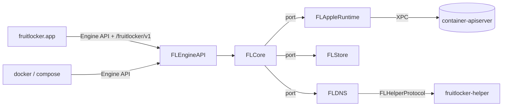
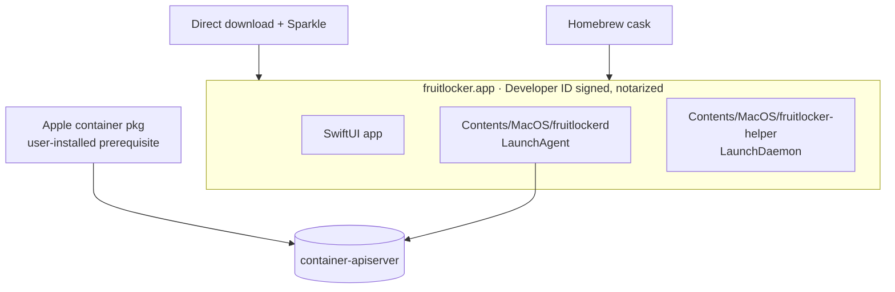

# Architecture Spine — fruitlocker v1

## Design Paradigm

**Hexagonal (ports and adapters)** around a Docker domain core, with **reconcile-loop controllers** for the behavior Apple's runtime lacks. Each controller watches events and drives runtime state toward the stored spec. Concurrency is Swift 6 actors in strict mode.

| Layer | Module | Holds |
|---|---|---|
| Core (domain) | `FLCore` | Docker object model and specs, services, ports (protocols), EventBus, controllers |
| Driving adapter | `FLEngineAPI` | Engine API HTTP over the Unix socket (Hummingbird), `/fruitlocker/v1/*` |
| Driven adapter | `FLAppleRuntime` | `ContainerAPIClient` over XPC to `container-apiserver` |
| Driven adapter | `FLStore` | Desired-spec persistence (SQLite) |
| Driven adapter | `FLDNS` | Compose resolver on sockets handed over by the helper |
| Shared contract | `FLHelperProtocol` | XPC interface between daemon and helper |
| Executables | `fruitlockerd`, `fruitlocker-helper`, `fruitlocker.app` | Composition roots only |



Dependency rule: adapters depend on `FLCore`, and `FLCore` depends on no adapter. Adapters never import each other. `fruitlocker-helper` depends only on `FLHelperProtocol`, and the app depends on no engine module.

## Invariants & Rules

### AD-1 — Three processes, one engine
- **Binds:** packaging, app, daemon, helper
- **Prevents:** engine lifetime tied to the UI; root code growing beyond socket binding
- **Rule:** `fruitlocker.app` is UI only. `fruitlockerd` is a per-user LaunchAgent, registered with `SMAppService`, that runs with or without the app open. `fruitlocker-helper` is a root LaunchDaemon, registered with `SMAppService`, whose whole job is AD-9.

### AD-2 — Only the daemon talks to Apple
- **Binds:** all modules
- **Prevents:** two writers of Apple state; the app drifting from what `docker` sees
- **Rule:** only `FLAppleRuntime`, inside `fruitlockerd`, links `ContainerAPIClient`. The app and the helper never contact `container-apiserver`, and nothing shells out to the `container` CLI or parses its output.

### AD-3 — The daemon owns the spec, Apple owns runtime [ADOPTED]
- **Binds:** containers, networks, volumes, controllers
- **Prevents:** two sources of truth for one object
- **Rule:**
  - `FLStore` is the source of truth for every Docker object's desired spec: config, names, labels, restart policy, healthcheck, network attachments and aliases, volume metadata.
  - `container-apiserver` is the source of truth for runtime status, which is always read live and never persisted as truth.
  - The Apple container is created from the spec at `docker start`. Edits before that (`network connect`, `rename`) change only the spec.
  - Apple objects carry only a back-reference label, `fl.docker.id`.

### AD-4 — Identity
- **Binds:** containers, networks, volumes, API responses
- **Prevents:** rename breaking Apple identity; ID formats drifting
- **Rule:**
  - The daemon mints 64-hex Docker IDs.
  - The Apple object ID is `fl-<first 12 hex of the Docker ID>` and never changes.
  - Docker names live only in the spec.
  - Image IDs are the Apple image config digest (`sha256:…`).

### AD-5 — One image store
- **Binds:** images, build, pull, push, load, save
- **Prevents:** a second content store diverging from Apple's
- **Rule:** Apple's image store is the only image store. The daemon stores no layers or image metadata beyond tags it reads from Apple.

### AD-6 — One event path
- **Binds:** `/events`, controllers, app views
- **Prevents:** duplicate or missing events; controllers each polling Apple
- **Rule:**
  - One in-process `EventBus` in `FLCore`.
  - Any mutation the daemon performs publishes its Docker event at the moment it happens.
  - The runtime poller diffs apiserver snapshots and publishes only for changes the daemon didn't cause, such as exits or edits made through Apple's CLI.
  - Controllers and `/events` subscribe to the bus. Only the poller reads apiserver state on a timer.

### AD-7 — One mutation path
- **Binds:** `FLEngineAPI`, `FLCore`
- **Prevents:** racing writes; handlers bypassing spec rules
- **Rule:** HTTP handlers call core services only. Core services are the only callers of the runtime and store ports. One actor per object kind (containers, networks, volumes, images) serializes mutations on that kind.

### AD-8 — Behavior Apple lacks is a controller
- **Binds:** restart policies, healthchecks, Compose DNS, network lifecycle
- **Prevents:** emulations scattered through handlers; each one inventing its own loop
- **Rule:** every Docker behavior Apple doesn't provide (restart, health, DNS, network ordering) is a controller in `FLCore`. Each controller subscribes to the `EventBus`, reads the spec from `FLStore`, and acts only through core services. When Apple ships the feature upstream, the controller is removed.

### AD-9 — DNS: the helper binds, the daemon answers [ADOPTED]
- **Binds:** `FLDNS`, `fruitlocker-helper`, `FLHelperProtocol`
- **Prevents:** root parsing guest traffic; the #4 wedge
- **Rule:**
  - The helper only binds `<gateway>:53` UDP, with `SO_REUSEADDR`, for gateways the daemon names. It never binds the wildcard.
  - It passes each bound fd to `fruitlockerd` over XPC, and closes its copy when the daemon asks or when the daemon's connection drops.
  - `FLDNS` parses, answers and forwards every packet, following the resolver rules from #4: keyed by source IP, scoped per network, multi-A, NODATA for AAAA, forwarding through `scutil --dns`.

### AD-10 — Network lifecycle is one controller
- **Binds:** networks, DNS, container start and stop
- **Prevents:** a DNS bind racing mDNSResponder (apple/container#402); networks sharing a bridge (apple/container#2051, fruitlocker #8)
- **Rule:** `NetworkController` is the only code that asks the helper to bind or release, and it follows the #5 guard:
  - It binds a gateway only after that network's bridge is up and mDNSResponder holds `udp4 *:53`.
  - It releases the gateway *before* stopping a network's last container.
  - It tracks bridges by event, not by polling.

  It also orders first starts and owns #8 detection. Docker's `bridge` network maps to a fruitlocker-owned Apple network, never to Apple's `default`.

### AD-11 — Unsupported fails loudly
- **Binds:** `FLEngineAPI`, `FLCore`
- **Prevents:** silent no-ops that make Compose files "work" wrongly
- **Rule:**
  - These options fail with an explicit error and are never ignored: host networking, `container:` network mode, shared PID or IPC, host-level privileged mode, devices, Docker-in-Docker, and `network connect` or `disconnect` on a running container.
  - Endpoints that aren't implemented return 501.
  - The error shape is in Consistency Conventions.

### AD-12 — Apple version gate
- **Binds:** `FLAppleRuntime`, startup
- **Prevents:** running against an apiserver whose XPC API isn't covered by Apple's 1.x promise
- **Rule:** link `ContainerAPIClient` at exactly 1.7.1. At startup, check that the installed apiserver is ≥ 1.7.1 with the same major version. If it isn't, refuse to serve and tell the app why.

### AD-13 — One socket, one extension namespace
- **Binds:** app, daemon
- **Prevents:** a second app-to-daemon channel whose view of state can drift
- **Rule:** the app talks to `fruitlockerd` only over its Engine API socket. It uses the Engine API for Docker objects and `/fruitlocker/v1/*` for engine-only concerns (status, settings, helper state, compatibility warnings). No other app↔daemon IPC.

### AD-14 — Credentials are never stored
- **Binds:** pull, push, `/auth`, build
- **Prevents:** fruitlocker becoming a credential store
- **Rule:** the daemon uses `X-Registry-Auth` and registry config for the request in hand only, and never persists it. `/auth` only validates.

### AD-15 — Docker context is additive
- **Binds:** app first run, settings
- **Prevents:** clobbering the user's other Docker setups
- **Rule:**
  - fruitlocker creates and owns one context named `fruitlocker`.
  - It never edits other contexts or `DOCKER_HOST`.
  - Switching to it records the previous context, so the switch can be undone.

## Consistency Conventions

| Concern | Convention |
|---|---|
| Engine API version | Implements v1.51 as max, min 1.44, with version negotiation via `/_ping` and `/version` `[ASSUMPTION]` |
| Socket and paths | `~/.fruitlocker/run/docker.sock` (no spaces, under the 104-char limit) `[ASSUMPTION]`; store and logs in `~/Library/Application Support/fruitlocker/` |
| Bundle and log ids | `sh.jawr.fruitlocker`, `.daemon`, `.helper` `[ASSUMPTION]`; OSLog subsystem = bundle id, category = module |
| Labels on Apple objects | `fl.docker.id` only (AD-3); Docker labels live in the spec and are surfaced through the API |
| Errors | Docker shape `{"message": "..."}`. Unsupported by constraint → 400 with `fruitlocker: <option> is not supported: <reason>`. Unimplemented → 501. Apple errors map to the nearest Docker status code, with Apple's message kept |
| Time and ids | RFC 3339 UTC in JSON, Unix seconds wherever Docker uses them; IDs per AD-4 |
| Concurrency | Swift 6 language mode, strict concurrency; shared mutable state only inside actors |
| Apple-native containers | Containers created with Apple's CLI show in `docker ps` with a synthesized spec; restart, health and DNS apply only to fruitlocker-created ones `[ASSUMPTION]` |
| Tests | Core tests run against a fake `AppleRuntime` port with no VMs. Anything that needs real VMs is a compatibility test (see Deployment) |

## Stack

| Name | Version |
|---|---|
| Swift (language mode 6, tools 6.2) | 6.2+ (built with 6.4.2, Xcode 27.2) |
| macOS (deployment target) | 26.0 |
| apple/container (`ContainerAPIClient`) | 1.7.1 exact |
| apple/containerization (via container) | 0.54.0 |
| Hummingbird | 2.28.1 |
| SwiftNIO | 2.105.0 |
| GRDB.swift (SQLite) | 7.12.0 `[ASSUMPTION]` |
| swift-log | 1.17.0 |
| swift-argument-parser | 1.8.2 |
| Sparkle | 2.10.1 `[ASSUMPTION]` |
| Compatibility targets: docker CLI / Engine, Compose | 29.9.3, v5.7.1 |

## Structural Seed

```text
fruitlocker/
  Package.swift                  # engine package: every module below
  Sources/
    FLCore/                      # domain, ports, EventBus, controllers
    FLEngineAPI/                 # Hummingbird routes, hijack handlers
    FLAppleRuntime/              # ContainerAPIClient adapter
    FLStore/                     # GRDB store
    FLDNS/                       # resolver on handed-over sockets
    FLHelperProtocol/            # daemon↔helper XPC contract
    fruitlockerd/                # daemon composition root
    fruitlocker-helper/          # root helper composition root
  Tests/                         # per-module tests against fakes
  App/                           # Xcode project: SwiftUI app, embeds daemon + helper
  Compat/                        # pinned Compose samples + matrix runner
  spikes/                        # throwaway spikes, never imported
```

### Deployment & environments



- **Distribution:** a direct download that updates with Sparkle, and a Homebrew cask pointing at the same notarized build `[ASSUMPTION]`.
- **Apple container:** the user installs Apple's signed pkg. fruitlocker detects it and guides the user through installing it, but doesn't bundle it `[ASSUMPTION]`.
- **CI:**
  - Unit and core tests run on GitHub-hosted macOS against fakes.
  - The compatibility matrix runs on a self-hosted Apple silicon runner, because GitHub's runners have no nested virtualization. That runner never runs code from fork PRs `[ASSUMPTION]`.

## Capability → Architecture Map

| Capability / Area | Lives in | Governed by |
|---|---|---|
| docker CLI core commands | `FLEngineAPI` → `FLCore` services | AD-2, AD-3, AD-7 |
| Compose service networking | `NetworkController`, `FLDNS`, helper | AD-9, AD-10 |
| Restart policies, healthchecks | `FLCore` controllers | AD-8 |
| `/events` | `EventBus`, runtime poller | AD-6 |
| Images, pull/push, `/auth` | image actor, `FLAppleRuntime` | AD-5, AD-14 |
| Build | open, see Deferred | AD-5 |
| Unsupported Docker features | `FLEngineAPI` validation | AD-11 |
| App views, logs, shell | app via socket | AD-13 |
| Docker context setup | app | AD-15 |
| Signed app, cask | `App/`, release pipeline | AD-1, Deployment |
| Compatibility matrix | `Compat/`, self-hosted runner | Deployment |

## Deferred

- **How builds run.** Docker 29 and Compose v5 build through buildx and Bake (BuildKit's `/session` and `/grpc`), not the legacy `/build`. Mapping that onto Apple's builder VM is unproven. **Open question; needs a spike before any build work.** AD-5 holds either way.
- **The fd-handover check for AD-9.** Confirm that a gateway socket bound with `SO_REUSEADDR` behaves the same after it's passed over XPC. That gets a small spike before `FLDNS` is built.
- **Hummingbird hijack fit.** The raw NIO escape hatch is assumed. It's proven by the first attach/exec story.
- **#8 mitigation strategy:** restart the network helper, order starts, or fix it upstream. Owned by AD-10 and decided in #8.
- **Store schema.** `FLStore` owns it; the code owns the detail.
- **Poll interval and event latency.** Tuned with measurements; AD-6 fixes the shape.
- **App UI structure.** Belongs to `bmad-ux`; AD-13 fixes its only seam.
- **Who hosts the self-hosted runner.** Open question for Josh.
- **After v1:** Dev Containers, Testcontainers (Docker-outside-of-Docker through a facade socket), Kubernetes, extensions.
